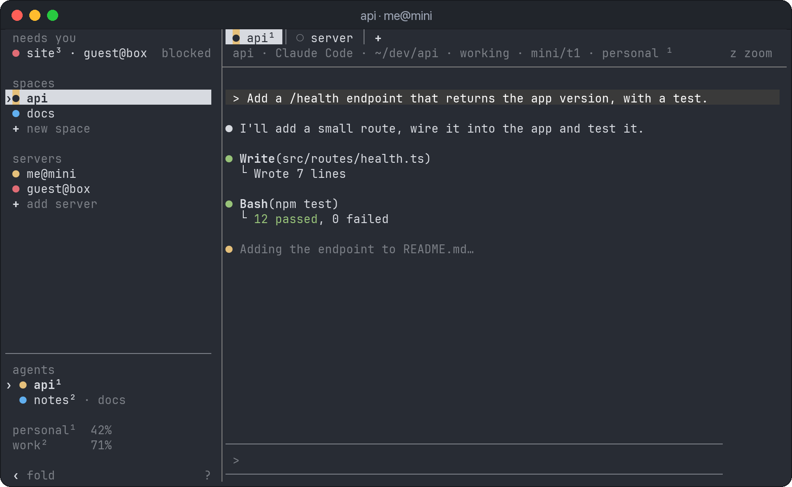

# hcGUI

<p>
  
  
</p>

A sidebar and a tab bar for herdr-core terminals and coding agents, in one Ghostty window on macOS.

Python 3 standard library, shell and tmux: no Python packages, no daemon, no network port of its own, no admin
rights asked. Machines and agents in the images are made up.

## What it is, and what it is not

- **A front end for herdr-core.** herdr-core (`hc`) keeps terminals and coding agents running on this Mac and on
  machines reached over SSH. hcGUI lists them and shows one at a time, through `hc attach`.
- **Not herdr-core.** herdr-core is a separate project, [herdrdev/herdr-core](https://github.com/herdrdev/herdr-core),
  and hcGUI is not made by its authors.
- **Not a terminal.** Ghostty draws the window; a tmux of the window's own splits it into sidebar, tab bar and view.
- **No connection of its own.** Every machine is reached through `hc`. The only other thing opened is a dev
  server's page, in the default browser, on a click.

## Features

- **Spaces.** The home machine's terminals, grouped by project.
- **Servers.** Every machine `hc machine ls` knows, as `user@host`. Hidden until shown (`v`).
- **Agents with live status.** `idle`, `working`, `done`, `blocked`, `error`, each a coloured dot (no word on the
  row), read every 2 seconds. Listed by space and server: a heading only for two or more agents; a single agent on one row, with its
  space dim after its name (`notes² · docs`).
- **Needs you.** A section at the top for agents `blocked`, in `error`, or `done` and not shown since. Present only
  while it has a row. Such an agent leaves the agents list until it no longer needs you.
- **Claude Code started from a shell.** `claude` typed in a terminal's shell is listed as an agent too, named
  Claude Code in the tab bar (found as the terminal's foreground program, every 30 seconds).
- **Account marks.** `¹ ² ³` after a Claude Code agent name the Claude login it bills, from the terminal's label
  `account` and `HCGUI_MARKS`.
- **5-hour usage.** One dim line per Claude subscription at the bottom of the sidebar: name, mark, share of its
  5-hour window used (`work²  71%`). Red from 95%. Read every 10 minutes. Needs the
  [setup below](#5-hour-usage).
- **Keychain warning.** One red line while the home machine's login keychain is locked: Claude Code there cannot
  read its login and bills the API instead. Read-only: the keychain is never unlocked, no password is asked for.
- **Dev servers.** Pages served by `node` on the home machine, one row per port. A click opens the page.
- **Menus.** A right click on a sidebar row opens its menu. A right click on a tab, or in the shown terminal, opens
  its menu: New terminal, Rename, Move to space, Close.
- **Safe deletes.** Delete space and End terminal list everything that ends and end it on `y`, taken only after
  half a second; any other key cancels. Forget server asks for the server's name to be typed first.
- **Drops.** A file dropped on the window reaches the shown terminal as its path. A terminal on another machine
  gets the file itself, copied with `hc put` over herdr-core's own connection; images over 8 MB go as a smaller
  JPEG.
- **One click, fast switching.** A click acts in any pane at once. 18 ms from a click to the new terminal's first
  byte on one machine; network time comes on top.
- **Display names.** Spaces, servers, terminals and subscriptions can be renamed in hcGUI; the names in `hc`
  stay. Kept in `names.json`.

<picture>
  <source media="(prefers-color-scheme: dark)" srcset="docs/tabmenu-dark.png">
  
</picture>

## Status needs agents that report it

The dots and Needs you come from the status each program reports to herdr-core. Claude Code 2.1.295 or newer
reports it by itself, also when started from a shell; `hc run` is not needed. Never reported when Claude Code runs
with `CLAUDE_CODE_DISABLE_TERMINAL_TITLE` set: its dot stays grey and it never shows in Needs you. Other programs
show a status only when they report one.

## Requirements

| What | Version |
|------|---------|
| macOS | Its own AppleScript, `lsof`, `security` and `sips` are used |
| Ghostty | 1.3.0 or newer |
| tmux | 3.5 or newer: `brew install tmux`. Tested with 3.8. `~/.tmux.conf` is never read |
| herdr-core | `hc` at `~/.local/bin/hc`, machines added with `hc machine add`. Tested with 0.1.21 |
| Python | `python3` 3.9 or newer with `curses`; the Xcode Command Line Tools' one is enough |
| git | `xcode-select --install` |
| jq | Only for the 5-hour usage, only on the home machine |

## Install

```sh
git clone https://github.com/PerIPan/herdr-core-GUI ~/.local/share/hcgui && sh ~/.local/share/hcgui/build.sh
```

Installed by an AI agent: point it to [AGENTS.md](AGENTS.md) first.

`build.sh` checks the requirements, then builds `hcGUI.app` in `/Applications` (in `~/Applications` when that
needs admin rights). Each start of the app opens one new Ghostty window. The app runs the files in
`~/.local/share/hcgui`, so the clone stays there.

Update, then close every hcGUI window and start the app again:

```sh
git -C ~/.local/share/hcgui pull && sh ~/.local/share/hcgui/build.sh
```

Remove:

```sh
rm -rf /Applications/hcGUI.app ~/Applications/hcGUI.app ~/.local/share/hcgui ~/.local/state/hcgui
```

**From hcG-UI.** Update as above. `build.sh` removes the old `hcG-UI.app`; folders and settings stay.
A clone made under the old name keeps working (GitHub forwards it).

**From mmini.** hcGUI was named mmini. Install as above, then remove the old folder
(`rm -rf ~/.local/share/mmini`). `build.sh` moves `~/.local/state/mmini` to `~/.local/state/hcgui` once (names,
widths and choices carry over), removes the old `mmini.app` and lists any `MMINI_` setting still in the shell:
rename each to `HCGUI_`.

## Setup

Most setups need none. `build.sh` ends with what is set and what is left.

| Case | What to set |
|------|-------------|
| Status dots and Needs you | Agents in herdr-core terminals (`hc`, or `claude` typed in one; `hc run` is not needed), Claude Code 2.1.295 or newer, `CLAUDE_CODE_DISABLE_TERMINAL_TITLE` unset: [Status needs agents that report it](#status-needs-agents-that-report-it) |
| Only this Mac | Nothing |
| This Mac and one server (`hc machine add`) | Nothing: the server is the home machine |
| Several servers | `export HCGUI_FIRST=<name>` in `~/.zshrc`: the machine whose terminals become spaces |
| 5-hour usage lines | A `statusLine` per Claude config folder on the home machine: [5-hour usage](#5-hour-usage) |
| Two or more subscriptions | The same `statusLine`, one name per subscription. Marks after agent names: `export HCGUI_MARKS="personal=¹,work=²"`, same names |

One subscription gets no mark and no name under the tabs: there is nothing to tell apart. Settings are read when a
window opens: close the windows and start the app again after a change. Every setting: [Settings](#settings).

## 5-hour usage

After each answer, Claude Code hands its status line command the share of the 5-hour window used and its reset
time ([status line input](https://code.claude.com/docs/en/statusline)). `usage.sh` is such a command: it saves the
numbers to `~/.local/state/hcgui/usage/<name>.json` and prints nothing. The status line stays empty. hcGUI reads
the files on the home machine through `hc exec`. No login, no token, no connection of its own.

On the home machine:

1. Put the files there (`build.sh` is not needed there):

   ```sh
   git clone https://github.com/PerIPan/herdr-core-GUI ~/.local/share/hcgui
   ```

   Skip this step when the home machine is this Mac.

2. Add a `statusLine` to each Claude Code config folder's `settings.json`, one name per subscription. In
   `~/.claude/settings.json`:

   ```json
   {"statusLine": {"type": "command", "command": "sh \"$HOME/.local/share/hcgui/usage.sh\" claude"}}
   ```

   A second subscription with its own folder (`CLAUDE_CONFIG_DIR=~/.claude-work`) gets the same line in that
   folder's `settings.json`, with its own name (`work`). Names: 1 to 32 of `A-Z a-z 0-9 . _ -`. A name in
   `HCGUI_MARKS` shows its mark.

   Folders sharing one `settings.json` pick the name by `CLAUDE_CONFIG_DIR`:

   ```json
   {"statusLine": {"type": "command", "command": "case \"${CLAUDE_CONFIG_DIR:-}\" in */.claude-work | */.claude-work/) n=work ;; *) n=claude ;; esac; sh \"$HOME/.local/share/hcgui/usage.sh\" \"$n\""}}
   ```

   The same line sets each terminal's label `account` to that name, once per terminal: the marks and the line
   under the tabs then know the subscription.

   A `statusLine` already there stays: run both, `usage.sh` first (it prints nothing, so the status line shows
   the other command's output):

   ```json
   {"statusLine": {"type": "command", "command": "i=$(cat); printf '%s' \"$i\" | sh \"$HOME/.local/share/hcgui/usage.sh\" claude; printf '%s' \"$i\" | <the command already there>"}}
   ```

3. Send a message in a session of each subscription. Its line shows within 10 minutes, or at once on `r`.

A right click on a line opens its menu: Rename, Refresh, Hide usage. A display name changes only what hcGUI draws.
Hidden (`u`), the files are not read. Off for good with `HCGUI_USAGE=0`.

## Keys

Sidebar (`?` shows the full list, then what the status dots mean):

| Key | Action |
|-----|--------|
| up/down, j/k | Move |
| enter | Show the terminal; the keyboard goes to it |
| a, right click | Menu of the row |
| n / s | New shell / new space (a name, or a folder starting with `/` or `~/`) |
| e / d | Rename / delete, end or forget |
| m | Move an agent to another space |
| v / g / w | Show or hide servers / agents / dev servers |
| u, right click on a usage line | Show or hide the 5-hour usage lines (the right click opens that line's menu) |
| c / o / q | Fold to a strip, then hide / open again / hide |
| [ ] (also - =) | Line above the agents up or down |
| z | The shown terminal gets the whole window; `‹ back` on top brings the panes back |
| r | Refresh now |

Tab bar: left/right or h/l between tabs, enter or down to the terminal, `?` for its keys. A tab dragged left or
right keeps its new place, in every window, per space or server; the agents list follows. "Sort by name" in a tab's
menu goes back to the names' order. The line below the tabs
shows the space, the herdr-core id, the subscription and the key hints for a few seconds each time a terminal is
shown, and again after a click on the bar anywhere but a tab.

Shown terminal: no tmux keys, so ctrl+b and every other key reach it. A drag selects and copies; shift+drag is
Ghostty's own selection; the wheel scrolls back (`q` or esc ends it). ctrl+\ detaches.

A menu opened with a right click takes clicks only: keys typed then go on to the terminal.

## Status dots

Every tab, and every agent in the sidebar, has a dot in the colour of its herdr-core status:

| Dot | Status | Meaning |
|-----|--------|---------|
| red | `blocked`, `error` | Waits for you (a permission or a question), or failed |
| yellow | `working` | Working |
| green | `done` | Finished its turn: an answer to read |
| blue | `idle` | Waiting, nothing new |
| grey, hollow | none | No status: a plain shell, or a program that reports none |

A space or server row shows the most urgent dot of its terminals.

## Settings

Environment variables, read at start; an `export` in `~/.zshrc` applies.

| Variable | Default | Effect |
|----------|---------|--------|
| `HCGUI_FIRST` | the only machine in `hc machine ls`, else this Mac | The home machine: its terminals become spaces; keychain, dev server and usage checks run there |
| `HCGUI_MARKS` | none | Account marks, `label=mark` pairs: `personal=¹,work=²`. An unlisted label gets `³` |
| `HCGUI_SHARED_USER` | none | An ssh user whose unlabelled Claude Code sessions get `HCGUI_SHARED_MARK` (`³`) |
| `HCGUI_WIDTH` / `HCGUI_NARROW` | `30` / `6` | Sidebar width, open / folded, until dragged |
| `HCGUI_HC` | `~/.local/bin/hc` | The `hc` program |
| `HCGUI_STATE` | `~/.local/state/hcgui` | The shared state folder |
| `HCGUI_DEV_PROGRAM` | `node` | The program whose ports are dev servers |
| `HCGUI_AUTOSIZE=0`, `HCGUI_AUTOOPEN=0`, `HCGUI_BROWSER=0` | on | No pane resizing / nothing shown until picked / no browser |
| `HCGUI_KEYCHAIN=0`, `HCGUI_USAGE=0` | on | No keychain check / no usage lines |

`usage.sh` sets the terminal's label `account` to its name (once per terminal; `HCGUI_ACCOUNT_LABEL=0` turns this
off). Without `usage.sh`, `hc label my-server/t3 account=work` gives that terminal's agent the mark `²`.

## How it works

`start.sh` runs a tmux server of the window's own (`hcgui.tmux.conf` only) with three panes, all `hcgui.py`:
the sidebar (`hc ls`, `hc get`, the checks through `hc exec`), the tab bar, and the view, a relay around
`hc attach` that passes every byte unchanged; only a drop for another machine is rewritten. The panes share files
in `~/.local/state/hcgui`, one folder per window, so two windows never switch each other's view. Closing a window
ends its panes; the terminals in herdr-core keep running.

A terminal's space is its label `space`, else its parent's, else its project folder below `~/dev`, else its
folder's name.

## Limits

- macOS only. Built against herdr-core 0.1.21's output; other versions untested.
- herdr-core 0.1.21 cannot rename a terminal: a rename is a display name in hcGUI only.
- Keychain check and dev servers expect the home machine to be a Mac. Dev servers: only the home account's own,
  only ports reachable from other machines.
- Drops to another machine: only programs that ask for bracketed paste (Claude Code does); others get the path on
  this Mac. At most 8 MB per file. Hidden files and `~/Library` are never sent, except iCloud Drive and the cloud
  storage folders there. A paste made only of file paths on this Mac counts as a drop. A drop not sent within 60
  seconds is pasted unchanged.
- 5-hour usage: the last number a session on the home machine saw; use on claude.ai, the phone apps or another
  machine shows with the next answer there. claude.ai subscriptions only, not API keys. Tried with Claude Code
  2.1.331, two subscriptions, one Mac mini.
- tmux sits between Ghostty and the terminal: Ghostty's scrollback and search see what tmux draws.
- Not tried in Ghostty itself: drops, and the keychain warning with a really locked keychain. The tests use a
  stand-in `hc`.

## Tests

```sh
/usr/bin/python3 -m unittest discover -s tests
```

Standard library only, under a minute. The real `hc` and Ghostty are never called; two tests start the real tmux
and are skipped without it.

## Licence

MIT, in `LICENSE`.
