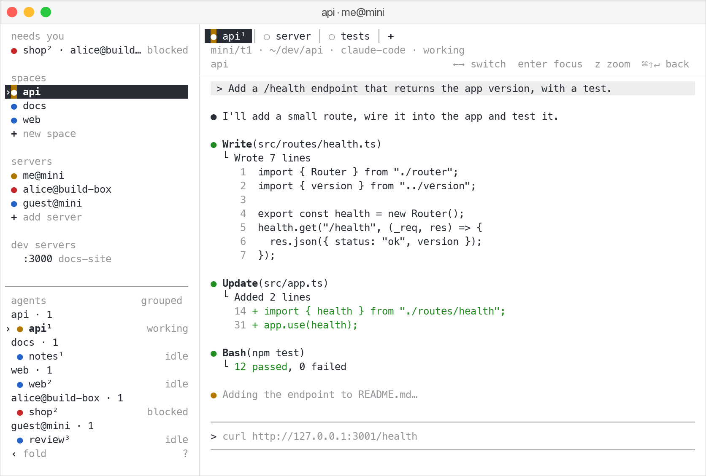
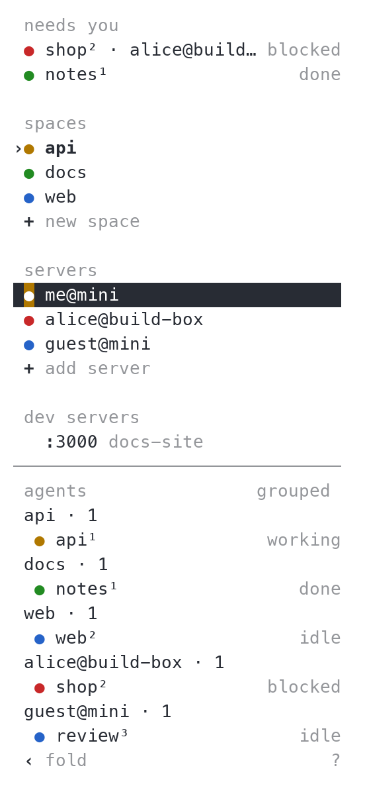
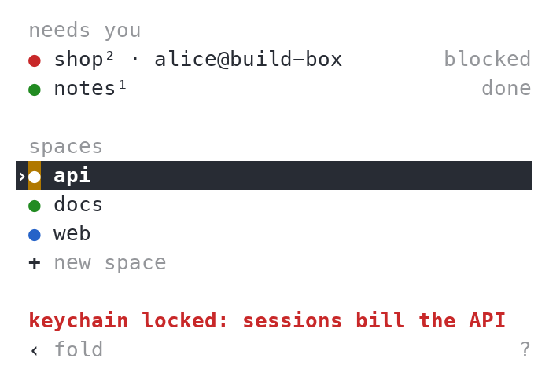
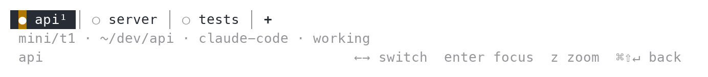
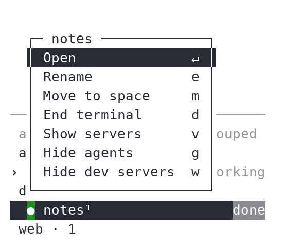

# herdr-core-ghostty-UI



A sidebar and a tab bar for herdr-core terminals and coding agents, in one Ghostty window on macOS.

The app is named **mmini**. Python 3 standard library and shell only: no packages, no daemon, no network port of
its own, no admin rights asked.

## Examples

Drawn from the real program's output; machines, projects and agents are made up.



Spaces, servers as `user@host`, a dev server and agents with their status; marks ¹ ² ³ name the Claude login each
session bills.



Needs you: an agent blocked on another server and one done but not shown since. The red line: the home machine's
login keychain is locked.



Tab bar: one tab per terminal of the space, the mark on the agent's tab, then the shown terminal's address, folder,
program and status.



The menu of an agent row, opened with a right click or `a`.

## What it is, and what it is not

- **A front end for herdr-core.** herdr-core (`hc`) keeps terminals and coding agents running on this Mac and on
  other machines reached over SSH. mmini lists them in a sidebar and a tab bar and shows one at a time, through
  `hc attach`.
- **Not herdr-core.** herdr-core is a separate project: [herdrdev/herdr-core](https://github.com/herdrdev/herdr-core).
  mmini is not made by its authors.
- **Not a terminal.** Ghostty draws every pane. mmini runs inside three of them.
- **No connection of its own.** Every machine is reached through `hc`. The only other thing mmini opens is a dev
  server's page, in the default browser, on a click.

## Features

- **Spaces.** The home machine's terminals, grouped by project. The home machine is `MMINI_FIRST`; unset, the only
  machine `hc machine ls` knows, else this Mac.
- **Servers.** Every machine `hc machine ls` knows, named `user@host` of its SSH target. Hidden until shown (`v`).
- **Agents with live status.** `idle`, `working`, `done`, `blocked`, `error`, as herdr-core reports them, each
  with a coloured dot. The list is read every 2 seconds.
- **Needs you.** One section at the top for agents that are `blocked` or in `error`, and agents `done` but not
  shown since. Shown only while it has a row.
- **Account marks.** Claude Code agents can carry a mark (`¹`, `²`, `³`) for the Claude login they bill, from the
  terminal's herdr-core label `account` (`hc label <terminal> account=<name>`) and the table in `MMINI_MARKS`. No
  table set: no marks. Read again every 30 seconds.
- **Keychain warning.** One red line while the home machine's login keychain is locked: Claude Code there cannot
  read its login from the keychain and bills the API instead. Checked at the start, then every 4 hours, every minute
  while locked. Read-only: the keychain is never unlocked and no password is ever asked for. Off with
  `MMINI_KEYCHAIN=0`.
- **Dev servers.** Web pages served by `node` (or `MMINI_DEV_PROGRAM`) on the home machine, one row per port, asked
  every 60 seconds. A click opens `http://<host>:<port>/` in the default browser.
- **Rename, create, delete.** Display names for spaces, servers and terminals; new spaces and shells; servers
  added with `hc machine add`. A delete asks for the name to be typed first.
- **Resizable.** The sidebar's divider and the line above the agents can be dragged with the mouse. Both are kept
  for the next window.
- **Hide sections.** Servers, agents and dev servers, each with one key.
- **Window title.** The shown terminal and its server: `api · me@my-server`.
- **Fast switching.** 18 ms from a click to the first byte of the new terminal, measured on one machine with its
  own terminals; network time comes on top. The old terminal stays on screen until the new one is drawn. Keys typed
  while nothing is shown are dropped, never passed to the next terminal.

## Requirements

| What | Version, place |
|------|----------------|
| macOS | AppleScript, `osacompile`, `lsof`, `perl`, `open` and `security` are used, all part of macOS |
| git | To install and update. Part of the Xcode Command Line Tools (`xcode-select --install`) |
| Ghostty | 1.3.0 or newer (its AppleScript control came with 1.3.0) |
| herdr-core | `hc` at `~/.local/bin/hc` (where its installer puts it), with the machines added (`hc machine add me@my-server`). Tested with 0.1.21 |
| Python | `python3` with `curses`, 3.9 or newer. The one from the Xcode Command Line Tools is enough |

## Install

```sh
git clone https://github.com/PerIPan/herdr-core-ghostty-UI ~/.local/share/mmini && sh ~/.local/share/mmini/build.sh
```

`build.sh` checks for `python3` with `curses`, `~/.local/bin/hc`, Ghostty and its version, then builds `mmini.app`
in `/Applications` (in `~/Applications` when `/Applications` is not writable without admin rights). The new app is
compiled beside the old one and replaces it only when the compile worked. The app starts the files in
`~/.local/share/mmini`, so the clone stays there. Each start of `mmini.app` opens one new Ghostty window.

Update:

```sh
git -C ~/.local/share/mmini pull && sh ~/.local/share/mmini/build.sh
```

Remove:

```sh
rm -rf /Applications/mmini.app ~/Applications/mmini.app ~/.local/share/mmini ~/.local/state/mmini
```

## Two Ghostty settings

Ghostty 1.3 has these only for all of its windows, so `build.sh` checks the config and prints the missing lines. It
never edits the config.

```
focus-follows-mouse = true
macos-titlebar-proxy-icon = hidden
```

- `focus-follows-mouse = true`: one click on a tab or a row is enough. Without it, the first click on a pane only
  gives it the keyboard. With it, the keyboard follows the pointer: move the pointer into the terminal before typing.
- `macos-titlebar-proxy-icon = hidden`: no folder icon next to the window title.

Reload the config in Ghostty afterwards: cmd+shift+, (comma).

## Keys

Sidebar (`?` shows the full list):

| Key | Action |
|-----|--------|
| up/down, j/k | Move |
| enter | Show the terminal; the keyboard goes to it |
| a, right click | Menu of the row |
| n | New shell in the space or server |
| s | New space (a name, or a folder starting with `/` or `~/`) |
| e / d | Rename / delete, end or forget |
| m | Move an agent to another space |
| v / g / w | Show or hide servers / agents / dev servers |
| c / o / q | Fold to a strip, then hide / open again / hide |
| [ ] (also - =) | Line above the agents one row up or down |
| z | The shown terminal gets the whole window; cmd+shift+enter brings the panes back |
| r | Refresh now |

Tab bar: left/right or h/l between tabs, enter or down to the terminal, `z` as above, `c` or `o` brings a hidden
sidebar back, `?` shows its keys.

In the shown terminal, ctrl+\ detaches (`hc attach`'s own key).

## Settings

Environment variables, read at start. Each pane's command is typed into Ghostty's own shell, so an `export` in that
shell's startup file (`~/.zshrc` for zsh, the macOS default) applies.

| Variable | Default | Effect |
|----------|---------|--------|
| `MMINI_FIRST` | the only machine in `hc machine ls`, else this Mac | The home machine's name in `hc`: its terminals become spaces; the keychain check and the dev servers run there. With no terminal on it, this Mac is home |
| `MMINI_HC` | `~/.local/bin/hc` | The `hc` program |
| `MMINI_WIDTH` | `30` | Width of the open sidebar in columns, until its divider is dragged |
| `MMINI_NARROW` | `6` | Width of the folded strip in columns |
| `MMINI_STATE` | `~/.local/state/mmini` | The shared state folder. Each window's own folder stays in `~/.local/state/mmini` |
| `MMINI_AUTOSIZE=0` | on | The sidebar and the tab bar never resize their panes |
| `MMINI_AUTOOPEN=0` | on | Nothing is shown until a terminal is picked |
| `MMINI_BROWSER=0` | on | A dev server is never opened in the browser |
| `MMINI_GHOSTTY=0` | on | No Ghostty calls at all (also no browser) |
| `MMINI_MARKS` | none: no marks | Account marks: `label=mark` pairs, for example `personal=¹,work=²`. A mark is one character. An `account` label not in the list gets `³` |
| `MMINI_SHARED_USER` | none | An ssh user: a Claude Code session without an `account` label on a server reached as this user gets `MMINI_SHARED_MARK` |
| `MMINI_SHARED_MARK` | `³` | The mark for `MMINI_SHARED_USER` |
| `MMINI_DEV_PROGRAM` | `node` | The program name whose listening ports are listed as dev servers (at most 15 characters) |
| `MMINI_KEYCHAIN=0` | on | No keychain check and no keychain warning |

Example, in `~/.zshrc`:

```sh
export MMINI_FIRST=my-server
export MMINI_MARKS="personal=¹,work=²"
```

Then `hc label my-server/t3 account=work` gives that terminal's agent the mark `²`.

## How it works

One Ghostty window, three panes, made with Ghostty's AppleScript splits:

- **Sidebar** (left): `python3 mmini.py sidebar`, drawn with curses. It lists the terminals (`hc ls`), reads labels
  and parents (`hc get`, every 30 seconds) and runs the keychain and dev server checks (`hc exec`).
- **Tab bar** (top right): `python3 mmini.py tabs`, one tab per terminal of the chosen space or server.
- **View** (below the tab bar): `view.sh`, which runs `hc attach` on the picked terminal.

The panes talk through files in `~/.local/state/mmini`: what is shown last, display names (`names.json`), section
choices, the sidebar width. Each window has its own folder there (`w-XXXXXX`), so two windows never switch each
other's view. Folders of closed windows older than two days are removed when the next window starts.

A terminal's space is its herdr-core label `space` (`hc label <terminal> space=<name>`), else its parent's space,
else the project folder below `~/dev`, else the last folder of its working directory (`home` for the home folder).

## Limits

- macOS only. Ghostty 1.3.0 or newer only.
- The keychain check and the dev server list expect the home machine to be a Mac (`/usr/bin/security`,
  `/usr/sbin/lsof`). A check that cannot run draws nothing.
- `build.sh` looks for `hc` only at `~/.local/bin/hc`, also when `MMINI_HC` is set.
- Built against herdr-core 0.1.21's JSON output. Other versions are untested.
- herdr-core 0.1.21 cannot rename a terminal: a rename is a display name in mmini only. The name in `hc` stays.
- Account marks need `MMINI_MARKS`: without it no label gives a mark. A label value not in it gets `³`. A mark
  is one character, one column wide, not an ASCII letter or digit.
- Dev servers: only programs named `MMINI_DEV_PROGRAM` (`node`), only of the account the home machine's herdr-core runs as (`lsof` without
  admin rights sees no others), only ports reachable from other machines. The page opens at the host part of the
  home machine's SSH target (`localhost` when home is this Mac); a `~/.ssh/config` alias that is not a real host
  name does not reach it.
- No Ghostty split is narrower than a tenth of the window, so the folded strip is about 12 columns on a 120-column
  window.
- A right click may open Ghostty's own menu instead of mmini's. The key `a` always works.
- The keychain warning was never seen with a locked keychain: the answer of `security` when locked is taken from
  macOS's error codes.
- The automated tests run without Ghostty and without a real `hc`. Not covered by them: the app and its window, the
  pane sizes, dragging in Ghostty, mouse clicks in Ghostty, adding or forgetting a real machine, switch time over
  the network, and opening a page in the browser.

## Tests

```sh
/usr/bin/python3 -m unittest discover -s tests
```

Standard library only, about 35 seconds. The tests never call the real `hc` and never call Ghostty.

## Licence

MIT. The licence text is in the `LICENSE` file.
