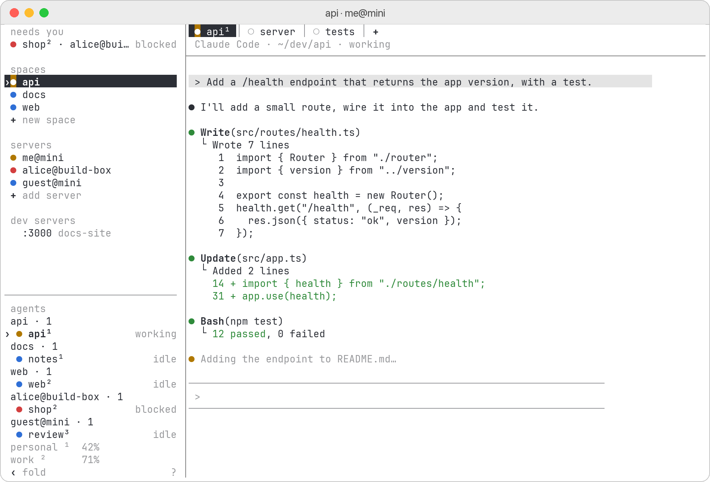
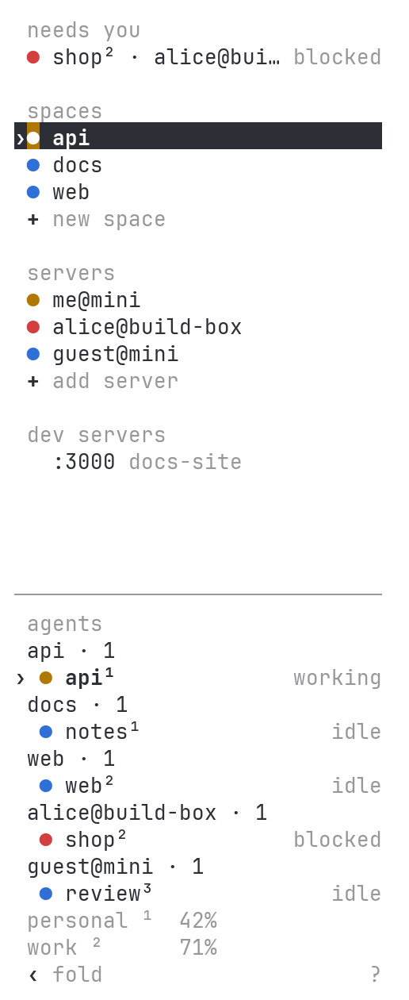
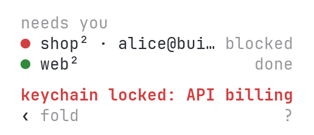
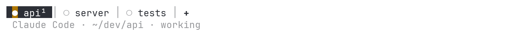
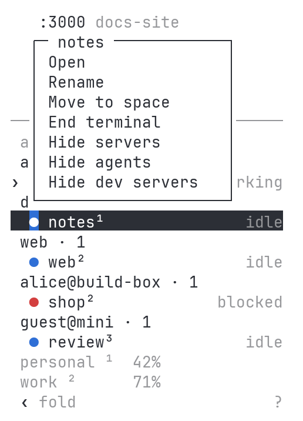

# herdr-core-ghostty-UI

<p>
  
  
</p>

A sidebar and a tab bar for herdr-core terminals and coding agents, in one Ghostty window on macOS.

The app is named **mmini**. Python 3 standard library, shell and tmux: no Python packages, no daemon, no network
port of its own, no admin rights asked.

## Examples

Drawn from the real program's output, in a dark and a light theme (these follow GitHub's); machines, projects
and agents are made up.

<picture>
  <source media="(prefers-color-scheme: dark)" srcset="docs/sidebar-dark.png">
  
</picture>

Spaces, servers as `user@host`, a dev server and agents with their status; marks ¹ ² ³ name the Claude login each
session bills.

<picture>
  <source media="(prefers-color-scheme: dark)" srcset="docs/needs-you-dark.png">
  
</picture>

Needs you: an agent blocked on another server and one done but not shown since. The red line: the home machine's
login keychain is locked.

<picture>
  <source media="(prefers-color-scheme: dark)" srcset="docs/tabbar-dark.png">
  
</picture>

Tab bar: one tab per terminal of the space, the mark on the agent's tab, then a line about the shown terminal: what
runs there, its folder and its status (`Claude Code · ~/dev/api · working`). Two rows in all. A click on the bar
anywhere but a tab or `+` adds, for a few seconds, the space's name at the start of that line, the terminal's
herdr-core id (`mini/t1`) at its end and the key hints at the right.

<picture>
  <source media="(prefers-color-scheme: dark)" srcset="docs/menu-dark.png">
  
</picture>

The menu of an agent row, opened with a right click (as here: clicks only, no keys shown) or with `a`.

<picture>
  <source media="(prefers-color-scheme: dark)" srcset="docs/tabmenu-dark.png">
  
</picture>

The menu of a tab, opened with a right click on the tab or in the shown terminal: New terminal, Rename, Move to
space, Close.

## What it is, and what it is not

- **A front end for herdr-core.** herdr-core (`hc`) keeps terminals and coding agents running on this Mac and on
  other machines reached over SSH. mmini lists them in a sidebar and a tab bar and shows one at a time, through
  `hc attach`.
- **Not herdr-core.** herdr-core is a separate project: [herdrdev/herdr-core](https://github.com/herdrdev/herdr-core).
  mmini is not made by its authors.
- **Not a terminal.** Ghostty draws the window and a tmux of the window's own splits it into three panes. mmini
  runs in all three.
- **No connection of its own.** Every machine is reached through `hc`. The only other thing mmini opens is a dev
  server's page, in the default browser, on a click.

## Features

- **Spaces.** The home machine's terminals, grouped by project. The home machine is `MMINI_FIRST`; unset, the only
  machine `hc machine ls` knows, else this Mac.
- **Servers.** Every machine `hc machine ls` knows, named `user@host` of its SSH target. Hidden until shown (`v`).
- **Agents with live status.** `idle`, `working`, `done`, `blocked`, `error`, as herdr-core reports them, each
  with a coloured dot (see [Status dots](#status-dots)). The list is read every 2 seconds.
- **Needs you.** One section at the top for agents that are `blocked` or in `error`, and agents `done` but not
  shown since. Shown only while it has a row.
- **Account marks.** Claude Code agents can carry a mark (`¹`, `²`, `³`) for the Claude login they bill, from the
  terminal's herdr-core label `account` (`hc label <terminal> account=<name>`) and the table in `MMINI_MARKS`. No
  table set: no marks. Read again every 30 seconds.
- **Keychain warning.** One red line while the home machine's login keychain is locked: Claude Code there cannot
  read its login from the keychain and bills the API instead. Checked at the start, then every 4 hours, every minute
  while locked. Read-only: the keychain is never unlocked and no password is ever asked for. Off with
  `MMINI_KEYCHAIN=0`.
- **5-hour usage.** At the bottom of the open sidebar, one line per Claude subscription: its name, its mark and the
  share of its 5-hour window used (`claude ¹  42%`). Always dim; red from 95%. The numbers are Claude
  Code's own, saved on the home machine by `usage.sh`; read every 10 minutes. A right click on a line opens its
  menu: Rename, Hide usage. A renamed subscription shows its new name on its line in every window, and in the `?`
  list when its name has a mark in `MMINI_MARKS`. Hidden with `u` or Hide usage; hidden, nothing is read. Needs the
  setup in [5-hour usage](#5-hour-usage); without it nothing is drawn. Off with `MMINI_USAGE=0`.
- **Dev servers.** Web pages served by `node` (or `MMINI_DEV_PROGRAM`) on the home machine, one row per port, asked
  every 60 seconds. A click opens `http://<host>:<port>/` in the default browser.
- **One click.** A click acts in any pane at once: tmux passes it to the pane under the pointer. After a pick the
  keyboard goes to the shown terminal.
- **Rename, create, delete.** Display names for spaces, servers, terminals and subscriptions (the usage lines); new
  spaces and shells; servers added with `hc machine add`. Delete space and End terminal list everything that ends
  and end it on `y`, taken only while the whole list shows and only half a second after it appears: a word typed
  into the sidebar by mistake ("tidy") ends nothing. Any other key cancels. When the list changed meanwhile, it is
  shown again and `y` is asked again. Forget server asks for the server's name to be typed first.
- **Tab menu.** A right click on a tab, or in the shown terminal, opens its menu: New terminal, Rename, Move to
  space, Close. Close lists everything that ends with the tab (the tab bar grows until the whole list shows) and
  closes on `y`; any other key cancels. When the list changed meanwhile, it is shown again and `y` is asked again.
  A menu opened with a right click is picked from with the mouse only: keys typed then go on to the terminal, so
  keys typed after an accidental right click never act on the menu. The same holds for the sidebar's row menu;
  once a question asked from a right-click menu is answered or cancelled with a key, the keyboard goes back to the
  shown terminal.
- **Drops land in the terminal.** A file dropped on the window reaches the shown terminal as its path, also when
  the sidebar or the tab bar had the keyboard. A terminal on another machine gets the file itself: it is copied
  there with `hc put`, over herdr-core's own connection to that machine, and its path on that machine is pasted in
  place of the path on this Mac. Images over 8 MB go as a smaller JPEG copy. A drop with a file that cannot be
  sent is pasted unchanged, and the tab bar says why.
- **Resizable.** The sidebar's divider and the line above the agents can be dragged with the mouse. Both are kept
  for the next window.
- **Hide sections.** Servers, agents, dev servers and the usage lines, each with one key.
- **Window title.** The shown terminal and its server: `api · me@my-server`.
- **Fast switching.** 18 ms from a click to the first byte of the new terminal, measured on one machine with its
  own terminals; network time comes on top. The old terminal stays on screen until the new one is drawn. Keys typed
  while nothing is shown are dropped, never passed to the next terminal.

## Requirements

| What | Version, place |
|------|----------------|
| macOS | AppleScript, `osacompile`, `lsof`, `perl`, `open`, `security` and `sips` are used, all part of macOS |
| git | To install and update. Part of the Xcode Command Line Tools (`xcode-select --install`) |
| Ghostty | 1.3.0 or newer (its AppleScript control came with 1.3.0) |
| tmux | 3.5 or newer: `brew install tmux`. Tested with 3.8. Only mmini's own settings are read (`mmini.tmux.conf`), never `~/.tmux.conf` |
| herdr-core | `hc` at `~/.local/bin/hc` (where its installer puts it), with the machines added (`hc machine add me@my-server`). Tested with 0.1.21 |
| Python | `python3` with `curses`, 3.9 or newer. The one from the Xcode Command Line Tools is enough |
| jq | Only for the 5-hour usage, only on the home machine: `/usr/bin/jq` where macOS has it, else `brew install jq` |

## Install

```sh
git clone https://github.com/PerIPan/herdr-core-ghostty-UI ~/.local/share/mmini && sh ~/.local/share/mmini/build.sh
```

`build.sh` checks for `python3` with `curses`, tmux and its version, `~/.local/bin/hc`, Ghostty and its version,
then builds `mmini.app`
in `/Applications` (in `~/Applications` when `/Applications` is not writable without admin rights). The new app is
compiled beside the old one and replaces it only when the compile worked. The app starts the files in
`~/.local/share/mmini`, so the clone stays there. Each start of `mmini.app` opens one new Ghostty window.

Update:

```sh
git -C ~/.local/share/mmini pull && sh ~/.local/share/mmini/build.sh
```

Then close every mmini window that was open and start `mmini.app` again: an open window keeps running the version
it started with. A window from a version without the subscriptions' display names drops them at its next rename,
close or delete.

Remove:

```sh
rm -rf /Applications/mmini.app ~/Applications/mmini.app ~/.local/share/mmini ~/.local/state/mmini
```

## 5-hour usage

After each answer, Claude Code hands its status line command the share of the subscription's 5-hour window used
and the time the window resets (`rate_limits` in
[Claude Code's status line input](https://code.claude.com/docs/en/statusline)). `usage.sh` is such a command: it
saves these two numbers (and the 7-day ones) to `~/.local/state/mmini/usage/<name>.json` and prints nothing. The
status line stays empty. mmini reads the files on the home machine through `hc exec`, every 10 minutes and at
once on `r`. No login, no token, no network connection of its own: only the numbers Claude Code already has.

Set it up on the home machine, where Claude Code runs:

1. Put the files there, in the same folder as on this Mac (`build.sh` is not needed there):

   ```sh
   git clone https://github.com/PerIPan/herdr-core-ghostty-UI ~/.local/share/mmini
   ```

   Skip this step when the home machine is this Mac: `usage.sh` is already in `~/.local/share/mmini`.

2. Add a `statusLine` to the `settings.json` of each Claude Code config folder, with one name per subscription.
   The default folder, `~/.claude/settings.json`:

   ```json
   {"statusLine": {"type": "command", "command": "sh \"$HOME/.local/share/mmini/usage.sh\" claude"}}
   ```

   A second subscription in a config folder of its own (`CLAUDE_CONFIG_DIR=~/.claude-2`), in
   `~/.claude-2/settings.json`:

   ```json
   {"statusLine": {"type": "command", "command": "sh \"$HOME/.local/share/mmini/usage.sh\" claude-2"}}
   ```

   Keep the other settings in the file; a `statusLine` set before is replaced. A name is 1 to 32 of the letters
   A to Z (upper or lower case, no accents), digits, `.`, `_` or `-`. A name with a mark in `MMINI_MARKS` shows that
   mark (`claude ¹`).

   When both config folders share one `settings.json` (one a link to the other), one command can pick the name by
   the folder, `CLAUDE_CONFIG_DIR` (unset for the default folder):

   ```json
   {"statusLine": {"type": "command", "command": "case \"${CLAUDE_CONFIG_DIR:-}\" in */.claude-2 | */.claude-2/) n=claude-2 ;; *) n=claude ;; esac; sh \"$HOME/.local/share/mmini/usage.sh\" \"$n\""}}
   ```

3. Send a message in a session of each subscription: its line shows at the next check (within 10 minutes), or at
   once on `r`.

The lines show the share used only. The reset time is read to tell a window that has passed: its line shows `0%`.
`u`, or Hide usage in the menu of a right click on a line, hides them in every window; hidden, the files are not
read. `u` again, or Show usage in any row's menu, brings them back, read at once.

Rename, in the same menu, gives a subscription a display name. It asks `rename claude to:`, the shown name typed
in. The display name replaces the name given to `usage.sh` on that line and, when that name has a mark in
`MMINI_MARKS`, in the `?` list's marks, in every window; the mark stays. An empty name, or the name given to
`usage.sh`, brings that name back. A name another line already shows, the name given to `usage.sh` for another
line, or a name the `?` list's marks stand for (every name in `MMINI_MARKS`, with a line or not, `other` and the
`MMINI_SHARED_USER` name) is refused, whatever its upper and lower case. A display name is 1 to 32 characters; one
too long for the sidebar is cut, marked `…`, and the mark and the share stay; in a sidebar too narrow to keep 4
characters of each cut name (under 14 columns for names of 5 characters or more), the lines with a mark then show
only the mark and the share. Kept in `~/.local/state/mmini/names.json` with the other display names. Only what
mmini draws changes: Claude Code, `usage.sh` and its files stay as they are.

Update it there with `git -C ~/.local/share/mmini pull`.

## Keys

Sidebar (`?` shows the full list, then what the status dots mean):

| Key | Action |
|-----|--------|
| up/down, j/k | Move |
| enter | Show the terminal; the keyboard goes to it |
| a, right click | Menu of the row |
| n | New shell in the space or server |
| s | New space (a name, or a folder starting with `/` or `~/`) |
| e / d | Rename / delete, end or forget |
| m | Move an agent to another space |
| v / g / w | Show or hide servers / agents / dev servers |
| u, right click on a usage line | Show or hide the 5-hour usage lines (the right click opens that line's menu: Rename, Hide usage) |
| c / o / q | Fold to a strip, then hide / open again / hide |
| [ ] (also - =) | Line above the agents one row up or down |
| z | The shown terminal gets the whole window; a click on the line on top (`‹ back`) brings the panes back |
| r | Refresh now |

Tab bar: left/right or h/l between tabs, enter or down to the terminal, a right click on a tab for its menu, `z` as
above, `c` or `o` brings a hidden sidebar back, `?` shows its keys. A click on the bar anywhere but a tab or `+`
shows the key hints and the terminal's herdr-core id for a few seconds.

In the shown terminal: a right click opens the tab menu of that terminal (not while zoomed: then the program gets
it); option+right click reaches a program that uses the mouse as option+right click. Keys typed after a right click
reach the terminal unchanged (ctrl+C, esc sequences and `;` included).

No tmux keys: tmux has no prefix here, so ctrl+b and every other key reach the shown terminal. Text in the shown
terminal: a drag selects it with tmux and copies it to the clipboard; shift+drag is Ghostty's own selection. The
mouse wheel scrolls back through tmux; while scrolled back, keys go to tmux (`q` or esc, or scrolling to the bottom,
ends it; a pick of another terminal ends it too).

In the shown terminal, ctrl+\ detaches (`hc attach`'s own key).

## Status dots

Every tab, and every agent in the sidebar, has a dot in the colour of its herdr-core status:

| Dot | Status | Meaning |
|-----|--------|---------|
| red | `blocked`, `error` | Waits for you (a permission or a question), or failed |
| yellow | `working` | Working |
| green | `done` | Finished its turn: an answer to read |
| blue | `idle` | Waiting, nothing new |
| grey, hollow | none | No status: a plain shell, or a program that reports none |

A space or server row shows the most urgent dot of its terminals: the first colour in this table that one of them
has. The `?` list in the sidebar ends with the same table, shortened.

## Settings

Environment variables, read at start. `start.sh` is typed into Ghostty's own shell, so an `export` in that shell's
startup file (`~/.zshrc` for zsh, the macOS default) applies.

| Variable | Default | Effect |
|----------|---------|--------|
| `MMINI_FIRST` | the only machine in `hc machine ls`, else this Mac | The home machine's name in `hc`: its terminals become spaces; the keychain check, the dev servers and the usage check run there. With no terminal on it, this Mac is home |
| `MMINI_HC` | `~/.local/bin/hc` | The `hc` program |
| `MMINI_WIDTH` | `30` | Width of the open sidebar in columns, until its divider is dragged |
| `MMINI_NARROW` | `6` | Width of the folded strip in columns |
| `MMINI_STATE` | `~/.local/state/mmini` | The shared state folder. Each window's own folder stays in `~/.local/state/mmini` |
| `MMINI_AUTOSIZE=0` | on | The sidebar and the tab bar never resize their panes |
| `MMINI_AUTOOPEN=0` | on | Nothing is shown until a terminal is picked |
| `MMINI_BROWSER=0` | on | A dev server is never opened in the browser |
| `MMINI_MARKS` | none: no marks | Account marks: `label=mark` pairs, for example `personal=¹,work=²`. A mark is one character. An `account` label not in the list gets `³` |
| `MMINI_SHARED_USER` | none | An ssh user: a Claude Code session without an `account` label on a server reached as this user gets `MMINI_SHARED_MARK` |
| `MMINI_SHARED_MARK` | `³` | The mark for `MMINI_SHARED_USER` |
| `MMINI_DEV_PROGRAM` | `node` | The program name whose listening ports are listed as dev servers (at most 15 characters) |
| `MMINI_KEYCHAIN=0` | on | No keychain check and no keychain warning |
| `MMINI_USAGE=0` | on | No usage check and no usage lines |

Example, in `~/.zshrc`:

```sh
export MMINI_FIRST=my-server
export MMINI_MARKS="personal=¹,work=²"
```

Then `hc label my-server/t3 account=work` gives that terminal's agent the mark `²`.

## How it works

One Ghostty window runs `start.sh`: a tmux server of the window's own, with `mmini.tmux.conf` only, and three panes:

- **Sidebar** (left): `python3 mmini.py sidebar`, drawn with curses. It lists the terminals (`hc ls`), reads labels
  and parents (`hc get`, every 30 seconds) and runs the keychain, dev server and usage checks (`hc exec`).
- **Tab bar** (top right): `python3 mmini.py tabs`, one tab per terminal of the chosen space or server.
- **View** (below the tab bar): `python3 mmini.py view`, a relay around `view.sh`, which runs `hc attach` on the
  picked terminal. The relay passes every byte on unchanged, both ways; only a drop for a terminal on another
  machine is rewritten (see Features). One relay per window: switching terminals starts no extra process.

tmux passes each click to the pane under the pointer, with no click spent on moving the keyboard first. Its own
keys, menus and status line are switched off; a line on top shows only while the view is zoomed. The sidebar and
the tab bar set their sizes exactly (30 columns, 2 rows) and again after the window changes size. Closing the
window ends its tmux and the three panes; the terminals in herdr-core keep running (only the view's `hc attach`
ends).

The panes talk through files in `~/.local/state/mmini`: what is shown last, display names (`names.json`), section
choices, the sidebar width. Each window has its own folder there (`w-XXXXXX`), so two windows never switch each
other's view. Folders of closed windows older than two days are removed when the next window starts.

A terminal's space is its herdr-core label `space` (`hc label <terminal> space=<name>`), else its parent's space,
else the project folder below `~/dev`, else the last folder of its working directory (`home` for the home folder).

## Limits

- macOS only. Ghostty 1.3.0 or newer and tmux 3.5 or newer only.
- The keychain check and the dev server list expect the home machine to be a Mac (`/usr/bin/security`,
  `/usr/sbin/lsof`). A check that cannot run draws nothing.
- `build.sh` looks for `hc` only at `~/.local/bin/hc`, also when `MMINI_HC` is set.
- Built against herdr-core 0.1.21's JSON output. Other versions are untested.
- herdr-core 0.1.21 cannot rename a terminal: a rename is a display name in mmini only. The name in `hc` stays.
- Account marks need `MMINI_MARKS`: without it no label gives a mark. A label value not in it gets `³`. A mark
  is one character, one column wide, not an ASCII letter or digit.
- Dev servers: only programs named `MMINI_DEV_PROGRAM` (`node`), only of the account the home machine's herdr-core runs as (`lsof` without
  admin rights sees no others), only ports reachable from other machines. The page opens at the host part of the
  home machine's SSH target (`localhost` when home is this Mac); a `~/.ssh/config` alias that is not a real host
  name does not reach it.
- Drops to a terminal on another machine reach only a program that asks for bracketed paste (Claude Code does).
  Any other program gets the path on this Mac, unchanged.
- A pasted path counts as a drop: while a terminal on another machine is shown, a paste made only of paths of
  files on this Mac (1 to 20 of them) sends those files there. A program on another machine can put such paths on
  this Mac's clipboard.
- Hidden files, files in hidden folders (a name that starts with a dot, such as `~/.ssh`) and files in this
  account's Library folder are never sent; iCloud Drive and the cloud storage folders inside Library are. Such a
  drop is pasted unchanged, and the tab bar says why.
- At most 8 MB per file (`hc put`'s limit). A larger image (PNG, JPEG, HEIC, HEIF, TIFF, GIF, BMP, WebP) goes as a
  JPEG copy of at most 2576 pixels a side, made with macOS's `sips` in a temporary folder only this account can
  read, and deleted right after, also when the window closes during the send. A larger file of another kind is not
  sent. `hc put` puts `_` in place of each space in the file name.
- Keys typed while a drop is sent wait and follow it. After half a second the tab bar says the drop is being sent.
  A drop not sent within 60 seconds is pasted unchanged, followed by the keys that waited.
- Files sent before a failed one stay on the other machine, and so may a file still being sent when the 60 seconds
  run out.
- A drop is pasted only into the terminal it was dropped on: when another terminal is shown by the time its files
  are sent, nothing is pasted, and the tab bar says so.
- A drop was never tried in Ghostty itself, nor with `hc put` to a real machine: the tests use a stand-in `hc`.
- tmux sits between Ghostty and the shown terminal: Ghostty's own scrollback and search see what tmux draws, and
  shift+enter and other modified keys reach the terminal as CSI u codes (tmux's extended keys), tried in a pseudo
  terminal, not yet in Ghostty.
- The keychain warning was never seen with a locked keychain: the answer of `security` when locked is taken from
  macOS's error codes.
- 5-hour usage: the number is the last one a session on the home machine saw. Use elsewhere (claude.ai, the Claude
  apps on a phone, Claude Code on another machine) shows up only with the next answer on the home machine. A window
  whose reset time has passed shows `0%` until the next answer starts a new one. Only claude.ai subscriptions: with
  an API key Claude Code hands no such numbers, and nothing is drawn. Only Claude Code of the account the home
  machine's herdr-core runs as: mmini reads that account's `~/.local/state/mmini/usage` (`MMINI_STATE` there is not
  read). `usage.sh` was tried as the status line of Claude Code 2.1.331 on one Mac mini, for two subscriptions.
- A session that still runs on another login than its config folder's (one started before a `/login` there)
  reports that login's numbers under the folder's name. A higher number is kept for 10 minutes at most, so the
  next answer of a right session puts it right.
- The automated tests run without Ghostty and without a real `hc`; two start the real tmux in a pseudo terminal
  (layout, sizes, a click, hiding and bringing back the sidebar; a drop pasted by tmux into the view and sent with a
  stand-in `hc put`). Not covered: the app and its window in Ghostty, the folder icon, mouse clicks, drags and drops
  in Ghostty itself, adding or forgetting a real machine, switch time over the network, and opening a page in the
  browser.

## Tests

```sh
/usr/bin/python3 -m unittest discover -s tests
```

Standard library only, under a minute. The tests never call the real `hc` and never call Ghostty. Two tests start
the real tmux; they are skipped when tmux is not installed.

## Licence

MIT. The licence text is in the `LICENSE` file.
